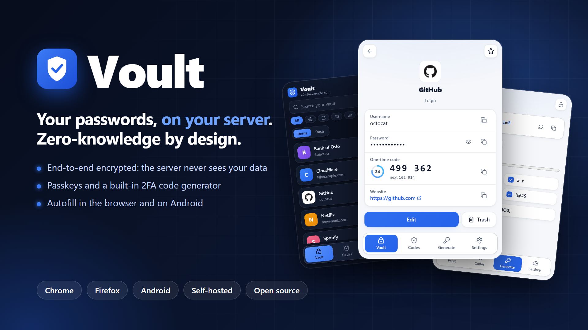
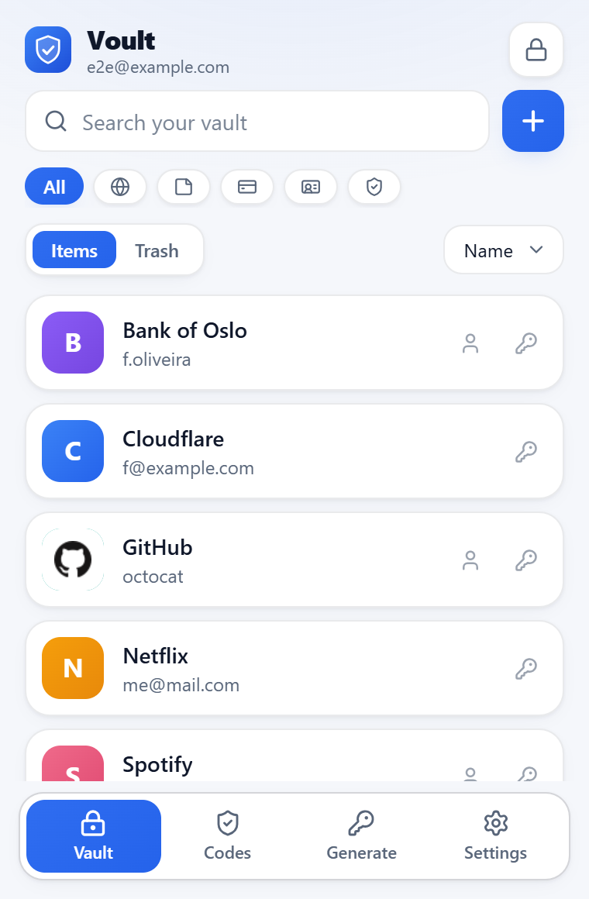
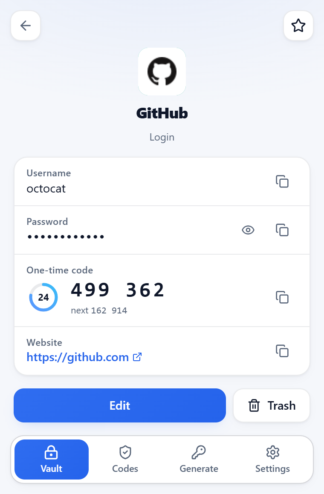
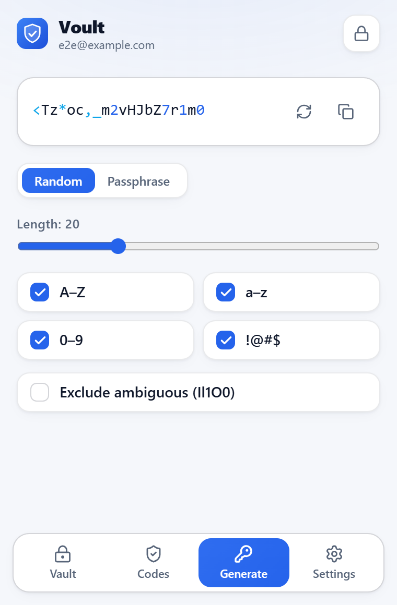
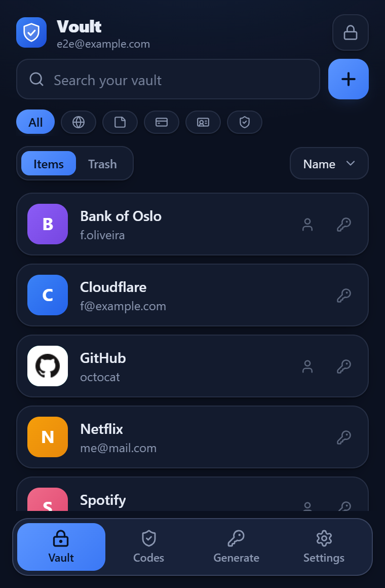

<div align="center">



# Voult

**A self-hosted, zero-knowledge password manager with a built-in 2FA client and passkeys.**
Chrome and Firefox extension, Android app, and a tiny server you run yourself.

[](https://github.com/fmgoliveira/voult/actions/workflows/ci.yml)
[](LICENSE)


</div>

> **Status:** feature-complete and in daily use, but young. It has had a self-review
> ([docs/SECURITY.md](docs/SECURITY.md)) and **no independent security audit yet**. Read the
> [limitations](docs/SECURITY.md) before trusting it with anything you cannot afford to lose, and keep
> a backup.

## Why Voult

- **Zero-knowledge.** Everything is encrypted on your device before it is synced. Your master password
  and keys never reach the server, so a stolen server, database or backup reveals nothing.
- **Yours.** One small Docker container and a SQLite file. No accounts with a vendor, no telemetry,
  no remote code in the extension.
- **Everything in one place.** Logins, notes, cards, identities, one-time codes and passkeys, with
  autofill in the browser and on Android.
- **Open source** under the AGPL-3.0, so you can read, audit and change every line that touches your
  secrets.

## Features

|                        |                                                                                                                                                                    |
| ---------------------- | ------------------------------------------------------------------------------------------------------------------------------------------------------------------ |
| **Vault**              | Logins, secure notes, cards and identities; search, favourites, trash with restore, password history                                                               |
| **2FA codes**          | Built-in TOTP generator with QR scanning, shown next to the login it belongs to                                                                                    |
| **Passkeys**           | Create and sign in with passkeys stored in your vault: in the browser through a software authenticator, and on Android 14+ through Credential Manager              |
| **Autofill**           | Browser: inline suggestions, save and update prompts, generated passwords on sign-up forms. Android: system autofill with keyboard suggestions and a bottom drawer |
| **Generator**          | Random passwords and passphrases with strength feedback                                                                                                            |
| **Sync**               | Conflict-safe sync between all your devices (revision checks, offline outbox), per-device revocation                                                               |
| **Quick unlock**       | Biometrics and a PIN on Android, a PIN in the extension, with auto-lock and clipboard clearing                                                                     |
| **Password health**    | Finds weak, reused and old passwords on-device, with an opt-in breach check (Have I Been Pwned, k-anonymity: only a 5-character hash prefix is sent)               |
| **Import**             | Chrome/Edge/Brave and Firefox CSV, 1Password CSV, Bitwarden JSON (with passkeys), Proton Pass JSON                                                                 |
| **Backups**            | Daily encrypted snapshots to _your_ Google Drive (narrow `drive.file` scope), or export a `.voult` file; restore onto any server with only your master password    |
| **Languages**          | English and Portuguese (follows the device), accessible colour contrast checked against WCAG 2.1 AA in CI                                                          |
| **Release automation** | Tagged releases build a signed APK, Chrome and Firefox packages and an auto-updating signed Firefox `.xpi`                                                         |

## Screenshots

<table>
  <tr>
    <td></td>
    <td></td>
    <td></td>
    <td></td>
  </tr>
  <tr>
    <td align="center">Vault</td>
    <td align="center">Login + 2FA code</td>
    <td align="center">Generator</td>
    <td align="center">Dark theme</td>
  </tr>
</table>

## Quick start

### 1. Run the server

You need Docker and a reverse proxy that provides HTTPS for your domain.

```bash
git clone https://github.com/fmgoliveira/voult.git
cd voult
cp .env.example .env            # then set JWT_SECRET (openssl rand -hex 32)
docker compose up -d --build    # listens on port 6565
```

Details, environment variables and optional Google Drive backups: [docs/INSTALL.md](docs/INSTALL.md).

### 2. Install the extension

Download the Chrome or Firefox package from the [latest release](https://github.com/fmgoliveira/voult/releases/latest)
(the Firefox `.xpi` updates itself), or build it yourself. Open it, enter your server URL and create
your account. See [docs/INSTALL.md](docs/INSTALL.md).

### 3. Install the Android app

Download `voult-*.apk` from the [latest release](https://github.com/fmgoliveira/voult/releases/latest),
install it, then enable Voult as your autofill and passkey provider. Step by step, including building
from source: [docs/ANDROID.md](docs/ANDROID.md).

## How it works

Your master password is stretched with Argon2id on the device into two halves: one proves who you are
to the server, the other unwraps your account key locally and never leaves the device. Items are
encrypted with XChaCha20-Poly1305 using per-item keys; the server stores ciphertext and minimal
metadata only. The full key hierarchy, threat model and known limitations are in
[docs/SECURITY.md](docs/SECURITY.md), and the moving parts are described in
[docs/ARCHITECTURE.md](docs/ARCHITECTURE.md).

## Repository layout

| Path                 | What                                                         |
| -------------------- | ------------------------------------------------------------ |
| `apps/extension`     | WXT (Manifest V3) browser extension                          |
| `apps/mobile`        | Expo Android app with a Kotlin autofill / passkey module     |
| `apps/server`        | Hono sync server on SQLite                                   |
| `packages/core`      | crypto, schemas, vault ops, TOTP, generator, sync, importers |
| `packages/ui-tokens` | shared design tokens                                         |
| `packages/config`    | tsconfig, ESLint, Vitest presets                             |

## Development

Requires Node 22+ and pnpm 12.

```bash
pnpm install
pnpm build
pnpm test
pnpm --filter @voult/server dev              # sync server
pnpm --filter @voult/extension dev           # Chrome (dev:firefox for Firefox)
pnpm --filter @voult/mobile android          # needs the Android SDK and a device
```

Contributions are welcome: please read [CONTRIBUTING.md](CONTRIBUTING.md) first. Report security
problems privately as described in [SECURITY.md](SECURITY.md). Release process:
[docs/RELEASE.md](docs/RELEASE.md). What changed: [CHANGELOG.md](CHANGELOG.md).

## License

[GNU AGPL-3.0](LICENSE). In short: you may use, study, modify and share Voult, and if you run a
modified version as a network service you must offer its source to the users of that service.
